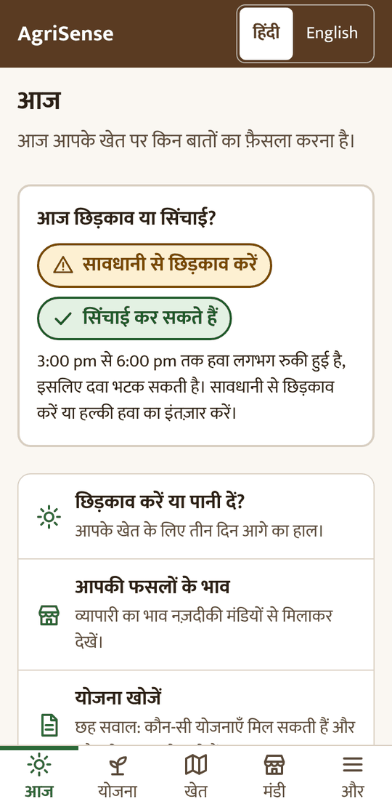
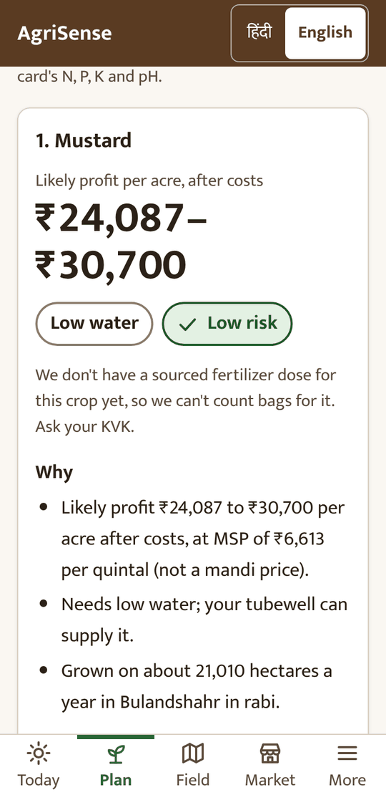
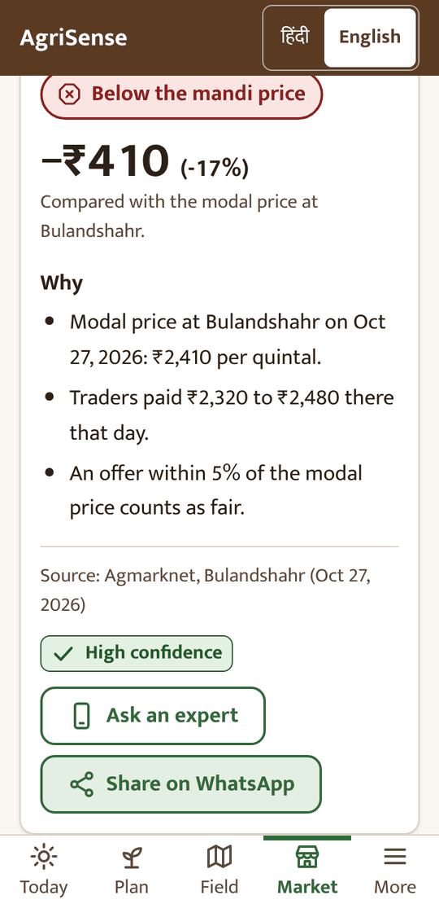
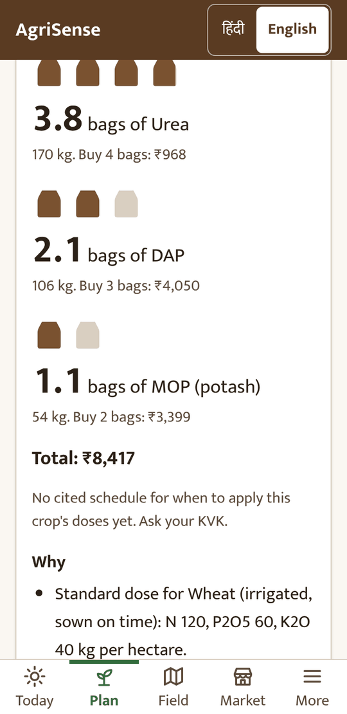
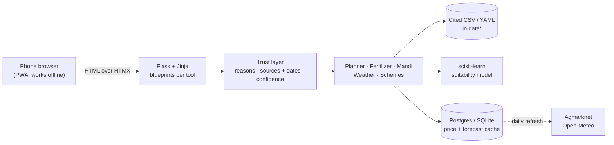

<div align="center">

# AgriSense 2.0

**Honest farm decisions for smallholders in north India, in Hindi and English.**

Which crop to sow, how many bags of fertilizer to buy, whether the trader's offer is fair,
whether to spray today, and which government schemes apply.
Every answer shows **why**, **where the numbers come from**, and **how sure it is**.

[](https://github.com/harshitpoooonia-star/CropSense/actions/workflows/ci.yml)


[](LICENSE)






<sub>Real screens at the 360 px baseline phone. Prices in these shots are synthetic test data.</sub>

</div>

---

## Why it exists

A smallholder in western Uttar Pradesh makes a handful of decisions each season that
decide the year: what to sow, how much fertilizer to buy, and who to sell to.
The advice they get usually comes from whoever is selling them something.
AgriSense is built to be the opposite. It sells nothing, names no brands, and never
makes up a number: every figure traces to a cited row in [`data/`](data/), and anything
it doesn't know, it says so and points to the local Krishi Vigyan Kendra (KVK).

## What it does

| Tool | The question it answers | How |
|---|---|---|
| **Crop Planner** | "What should I sow this rabi?" | Ranks crops by suitability × likely profit × risk, using district yields (DES), cost of cultivation, MSP and a calibrated scikit-learn suitability model. Three cards, each with "why" and "why not". |
| **Fertilizer** | "How many bags do I buy?" | Turns the ICAR dose (adjusted for your Soil Health Card if you have one) into urea / DAP / MOP bags and rupees at subsidised prices. |
| **Mandi Prices** | "Is ₹2,000 a fair offer?" | Daily Agmarknet prices for the nearest mandis, after transport cost, with a fair-offer band; anything over 3 days old is labelled. |
| **Spray & Irrigate** | "Can I spray today?" | Open-Meteo forecast through tested verdict rules: rain wash-off, drift, and whether rain will do the watering. |
| **Scheme Finder** | "Which schemes can I claim?" | Six questions against eligibility rules kept in YAML, one entry per scheme, checked against official pages, plus the papers to carry. |
| **My Farm** | "Remember my field." | Works fully as a guest; optionally save with phone + PIN. Phones are stored as peppered hashes; PIN resets go through a KVK/FPO helper in person. |

## How it's built



The decisions behind it are written down as [architecture decision records](docs/adr/):
server-rendered HTML with HTMX instead of a SPA (ADR-001), Postgres on Neon (ADR-002),
cached external data with staleness labels (ADR-004), and offline-first caching (ADR-006).

**Principles the code enforces, not just states**

- **Trust layer on every answer.** No tool can return a result without reasons, dated sources and a confidence level.
- **Budgets checked in CI.** First load under 300 KB of JS+CSS and LCP under 3 s on throttled 4G at 360 px ([`scripts/perf_budget.py`](scripts/perf_budget.py)).
- **Hindi first.** Every string goes through Flask-Babel; a test fails if a template has raw text. One self-hosted typeface (Mukta) covers Devanagari and Latin.
- **Accessible by default.** 48 px tap targets checked on every page, status shown as icon + word + colour, WCAG contrast pairs re-checked by [`tests/test_design_tokens.py`](tests/test_design_tokens.py). See the [design system](docs/design-system.md).
- **Works without JavaScript.** HTMX is the only JS library; every form posts normally without it.

**Quality:** ~485 unit tests (SQLite and Postgres) and 86 Playwright browser tests at 360×740 in Hindi,
including accessibility checks, an offline flow and a rehearsal of six moderated farmer tasks.

## Status

The software for v2.0.0 is complete and its checks pass. Before the release tag, the team still has to
run the moderated sessions with farmers and do the first production deploy; see
[docs/launch-review.md](docs/launch-review.md). Planning docs: [spec](docs/AgriSense-2.0-spec.md),
[roadmap](docs/AgriSense-2.0-roadmap.md), [per-tool specs](docs/specs/), [research kits](docs/research/).

## Run it locally

Python 3.14 (see `.python-version`).

```bash
python -m venv .venv
.venv\Scripts\activate            # macOS/Linux: source .venv/bin/activate
pip install -r requirements-dev.txt
python -m playwright install chromium

set AGRISENSE_ENV=development     # PowerShell: $env:AGRISENSE_ENV="development"
flask --app wsgi db upgrade       # creates agrisense-dev.db (SQLite)
flask --app wsgi run              # http://127.0.0.1:5000
```

`AGRISENSE_ENV` defaults to `production`, which refuses to start without its
environment variables, so local runs must set `development`.

## Configuration (environment only)

| Variable | Needed in | What |
|---|---|---|
| `AGRISENSE_ENV` | all | `production` (default), `development`, `testing` |
| `SECRET_KEY` | production | Flask session signing; long random string |
| `DATABASE_URL` | production | Neon Postgres URL (`postgres://` is fine) |
| `PHONE_PEPPER` | production | Key for hashing phone numbers. **Never change it** without a re-hash plan: every saved farm's login depends on it |
| `DATA_GOV_IN_KEY` | optional | Agmarknet API key (Section 7, Gate 0 script) |
| `REFRESH_TOKEN` | optional | Protects the price warm-up endpoint (Section 7) |

Never put real values in a file in this repo.

## Styles, fonts and translations

The built CSS, HTMX, the Mukta fonts and the compiled `.mo` catalogues are
committed, so Render needs no Node or build tools.

```bash
python scripts/build_css.py        # after changing templates or static/src/app.css
pybabel extract -F babel.cfg -k _l -k lazy_gettext --no-location --sort-output -o agrisense/translations/messages.pot .
pybabel update -i agrisense/translations/messages.pot -d agrisense/translations --no-fuzzy-matching
pybabel compile -d agrisense/translations   # after editing hi/LC_MESSAGES/messages.po
python scripts/get_assets.py htmx fonts     # only when bumping a pinned version
python scripts/build_icons.py               # after editing static/icons/icon.svg
```

## Offline and performance

The app installs to the home screen and keeps pages and each tool's last
answer for offline use ([ADR-006](docs/adr/ADR-006-offline.md)). Static URLs
carry a content hash (`?v=`) and are cached for a year; responses are
compressed (Flask-Compress).

```bash
python scripts/perf_budget.py   # JS+CSS < 300 KB and LCP < 3 s at 360 px, slow 4G, 4x CPU
```

`/styleguide` shows every UI macro in Hindi and English (on in development;
set `STYLEGUIDE=1` to show it in production). Design tokens and rules:
[docs/design-system.md](docs/design-system.md).

## Crop Planner data

Every figure the planner shows comes from a cited row in `data/`; rows stay
`verified=false` until a team member checks them against the source.

```bash
python scripts/build_crop_data.py --download   # DES yields (APY/UPAG) + UP cost of cultivation -> economics, seasons
python scripts/build_climate.py                # Open-Meteo history -> district season climate
python scripts/train_suitability.py            # legacy suitability model, no PCA, calibrated
python scripts/validate_planner.py             # top-3 hit rate on data/farm_records.csv
```

MSPs live in `data/msp.csv` and are updated by hand when the Cabinet announces them.
Spec: [docs/specs/02-crop-planner.md](docs/specs/02-crop-planner.md).

## Mandi prices

Prices come from Agmarknet (data.gov.in) into a cache table; pages read the
cache and label anything older than 3 days.

```bash
flask --app wsgi agrisense refresh-prices --days 3   # needs DATA_GOV_IN_KEY
python scripts/build_mandis.py                       # mandi towns + coordinates (Wikidata)
```

In production a scheduled GitHub Actions workflow (`refresh-prices.yml`) calls
`POST /internal/refresh/prices` daily. Set the repository secrets
`REFRESH_URL` (the Render URL) and `REFRESH_TOKEN` (same value as the app's
`REFRESH_TOKEN` env var); without them the workflow skips. The "fair offer"
band is `FAIR_BAND_PCT` (default 5, for team review).
Spec: [docs/specs/04-mandi.md](docs/specs/04-mandi.md).

## Tests

```bash
pytest                            # unit tests; network is blocked
python scripts/run_e2e.py         # Playwright guest smoke test at 360 px
```

CI (GitHub Actions) runs the unit tests on SQLite and Postgres, applies and
checks the migrations on Postgres, and runs the browser smoke test.

## Admin

```bash
flask --app wsgi agrisense make-helper   # make a KVK/FPO helper who can reset PINs
```

A farmer who forgets their PIN asks a helper. The helper confirms the farmer
in person, gets a one-time code at `/helper/pin-reset`, and the farmer sets a
new PIN at `/pin/reset`.

## Deploy (Render)

- Build: `pip install -r requirements.txt && flask --app wsgi db upgrade`
  (free tier; Render's separate pre-deploy command is paid)
- Start: `gunicorn wsgi:app`
- Follow [docs/deploy-checklist.md](docs/deploy-checklist.md) every time.

## Team

Built as a Design Thinking & Innovation (DTI) project at **Bennett University** by
Harshit Poonia, Shivansh Gupta, Anaya Bakshi, Tushita and Anant Vaibhav.

## License

[MIT](LICENSE)
